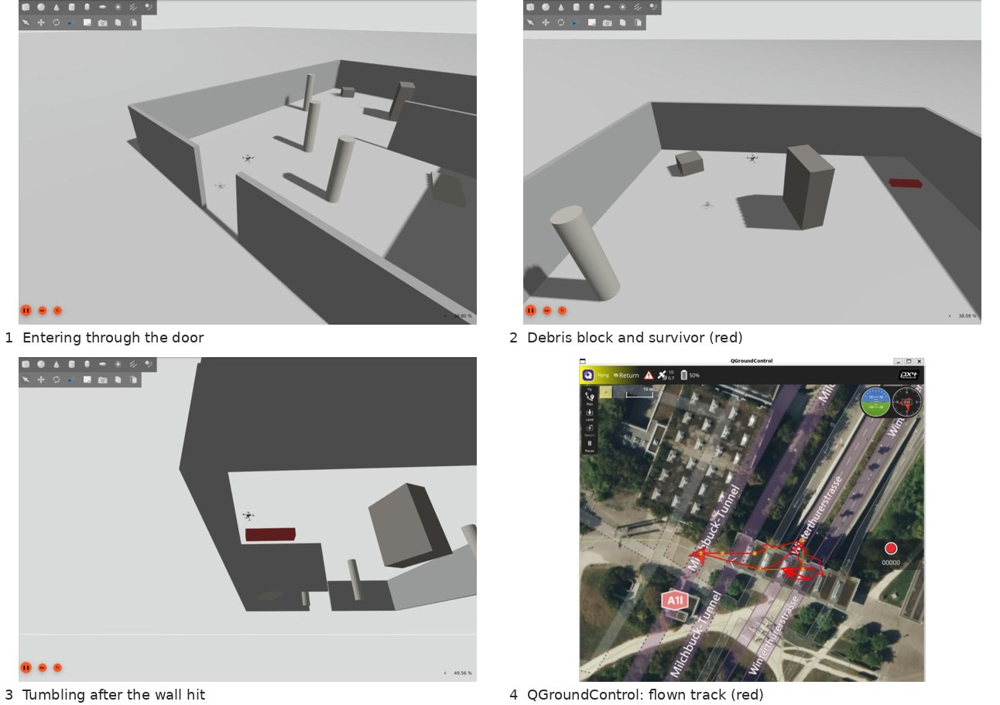
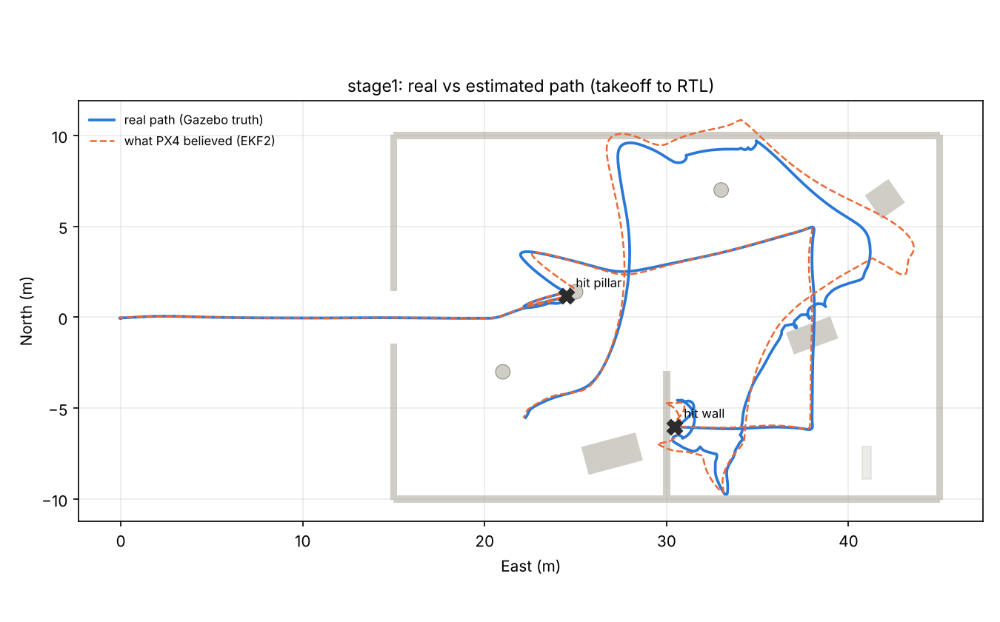

# Lost-Link SAR

**A search-and-rescue drone that knows when it's about to lose its way home.**

A quadcopter flies a search mission inside a damaged building. At the entrance it loses GPS (jammed). Inside, it loses its radio link to the ground station. From then on it has to keep searching, avoid debris, and decide *by itself* when to turn back, before it drifts too far to make it home.

Built on PX4 + Gazebo + QGroundControl + ROS2, fully in simulation, with a path to a real lightweight drone.





*Stage 1 baseline: a standard QGroundControl mission flown through a damaged building. Blue: the drone's real path (Gazebo ground truth). Orange dashed: what PX4 believed. X: collisions. After hitting the wall, the drone tumbled across the room for 9 s, and its own position estimate drifted up to 2.6 m from reality even with GPS. A normal mission has no awareness of obstacles. That's the problem this project solves.*

---

## The idea in one table

| Piece | Built on | What it does |
|---|---|---|
| Local obstacle avoidance | EGO-Planner (Zhou et al., ZJU FAST Lab), re-implemented in ROS2 | Bends the flight path around obstacles seen by the depth camera |
| Path home | GBPlanner (NTNU ARL, DARPA SubT winner) | Keeps a graph of known-safe routes back to base |
| **Return decision (new)** | This project | Triggers return when the risk of *not getting home* crosses a limit. The risk combines GPS-free position drift, radio link status and battery, not just a fixed battery threshold. |

Full background and references: [docs/01_concept.md](docs/01_concept.md)

## Progress

| Stage | Goal | Status | Write-up |
|---|---|---|---|
| 0 | Plain QGroundControl waypoint mission, empty world | ✅ Done | [stage0_baseline.md](docs/stage0_baseline.md) |
| 1 | Same mission through a damaged building: show it crashes | ✅ Done | [stage1_obstacle_world.md](docs/stage1_obstacle_world.md) |
| 2 | ROS2 offboard node: depth camera → obstacle avoidance | ⏭️ Next | – |
| 3 | GPS denial mid-mission, drifting position estimate | Planned | – |
| 4 | Return-home decision + comms loss: experiments for the paper | Planned | – |

Day-by-day problems and fixes: [docs/lab_notebook.md](docs/lab_notebook.md)

## Quick start

Tested on Windows 11 + WSL2 Ubuntu 22.04, ROS2 Humble, PX4 v1.18.0-beta1, Gazebo Harmonic (gz-sim 8). Full install guide: [docs/00_setup.md](docs/00_setup.md)

```bash
# Terminal 1: build the damaged-building world + mission and start the simulator
bash sim/scripts/run_stage1.sh

# Terminal 2: once PX4 says "Ready for takeoff", stop the corner cutting
bash sim/scripts/set_params.sh

# QGroundControl: Plan > Open > sim/missions/stage1_obstacle_mission.plan > Upload > Fly > start
# After landing: truth-vs-estimate report from the newest log
python3 sim/scripts/flight_report.py ~/PX4-Autopilot/build/px4_sitl_default/rootfs/log/<date>/<time>.ulg --stage stage1
```

## Repository layout

```
docs/          concept, setup guide, one page per stage, lab notebook
sim/worlds/    Gazebo world generator (obstacles + matching mission in one place)
sim/missions/  QGroundControl .plan files
sim/scripts/   run, parameter, log-analysis and plotting helpers
ros2_ws/       ROS2 packages (from Stage 2)
results/       figures and data per stage
media/         screenshots and videos
```

Flight logs (`.ulg`) are too large for the repo and are attached to GitHub Releases.

## Author

Kareena Mueenuddin, B.Tech Mechatronics Engineering (Amity University Dubai). Robotics, autonomous systems, UAV path planning.
