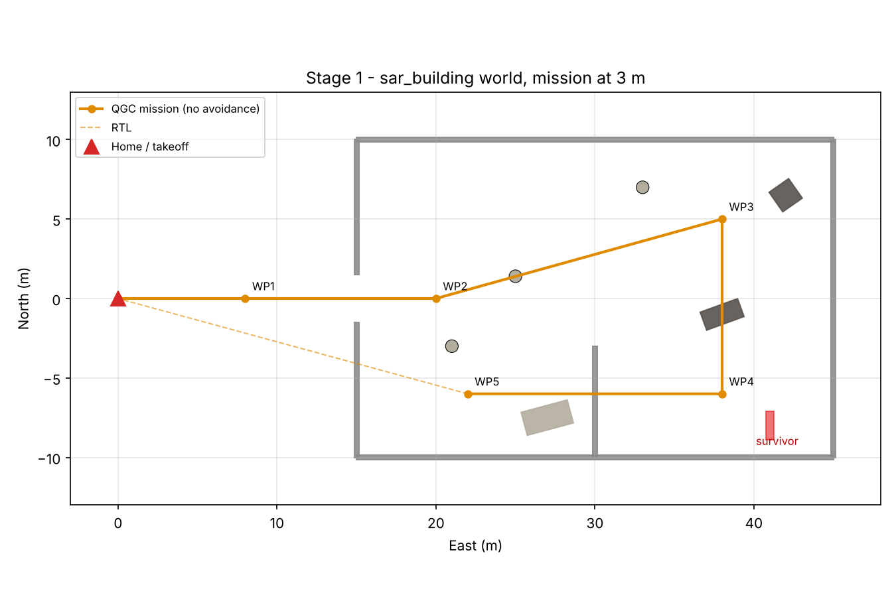
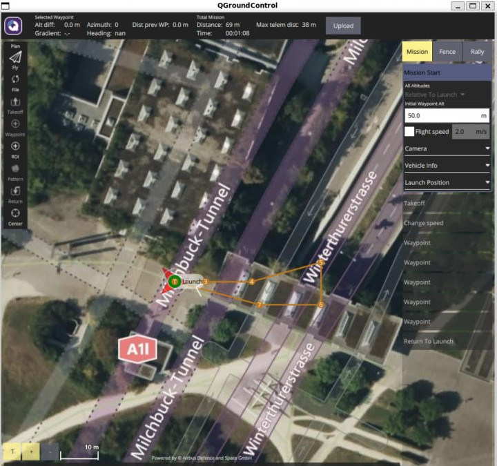
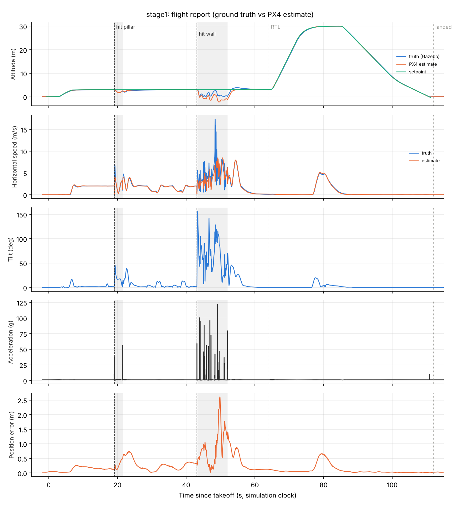
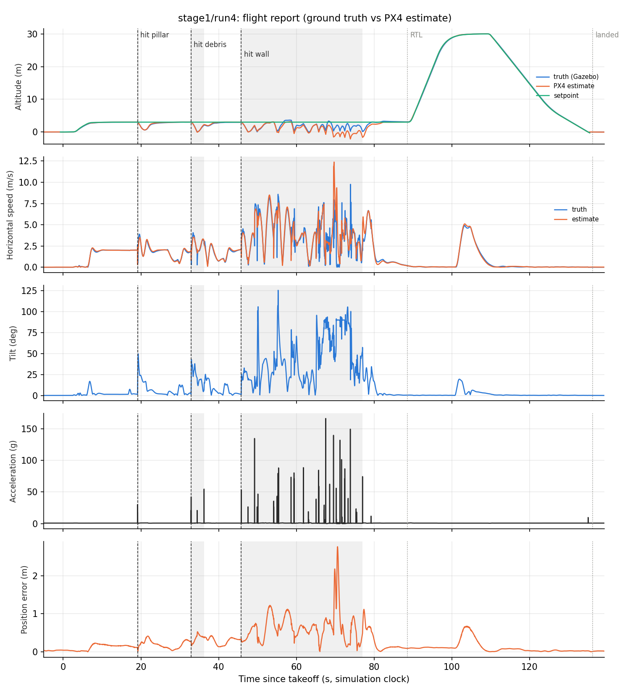
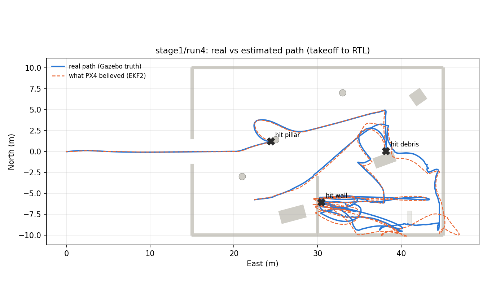

# Stage 1: Damaged-building world (problem statement)

**Dates:** 5 Oct 2026 (runs 1–3), 12 Oct 2026 (run 4 + screenshots)  **Status:** ✅ Done

## Goal

Show that a standard QGroundControl waypoint mission has no awareness of obstacles. Fly it through a cluttered building at low altitude and measure what happens. This is the "before" result that Stage 2 has to beat.


## The world: `sar_building`

Generated by `sim/worlds/make_stage1.py`. A single script defines the obstacles **and** the mission, so the two always line up. It copies PX4's own `default.sdf`, keeping all the sensor plugins and the GPS origin, and adds static obstacles.

| Element | Size / position (East, North in m; origin = takeoff point) |
|---|---|
| Building | 30 × 20 m footprint (x 15→45, y −10→10), 4 m walls, 0.3 m thick |
| Door | 3 m gap in the west wall at y = 0 |
| Partition wall | inside, x = 30, from y = −10 to −3 |
| Pillars (×3) | Ø 0.8 m, 4 m tall, at (25, 1.4), (33, 7), (21, −3) |
| Debris block | 2.5 × 1.2 m at (38, −1), **3.5 m tall** (was 2.5 m in runs 1–3) |
| Fallen slab, rubble | low clutter, (27, −7.5) and (42, 6.5) |
| Survivor | red marker at (41, −8), visual only, no collision. This is the search target. |



## The mission: `sim/missions/stage1_obstacle_mission.plan`

Takeoff to **3 m** (below the wall tops) → speed set to **2 m/s** → WP1 (8, 0) outside the door → WP2 (20, 0) just inside → WP3 (38, 5) → WP4 (38, −6) → WP5 (22, −6) → RTL.

Each leg was deliberately placed through an obstacle: WP2→WP3 through pillar 1, WP3→WP4 through the debris block, WP4→WP5 through the partition.



## How to run it

```bash
bash sim/scripts/run_stage1.sh          # terminal 1: world + mission + PX4/Gazebo
bash sim/scripts/set_params.sh          # terminal 2: NAV_ACC_RAD = 0.5
```

QGroundControl: Plan → Open the `.plan` → Upload → Fly → start. After landing:

```bash
python3 sim/scripts/flight_report.py <log.ulg> --stage stage1 --labels "hit pillar,hit debris,hit wall"
```

## All runs

| Run | Date | Setting | Result |
|---|---|---|---|
| 1 | 5 Oct | PX4 defaults | **No collision.** The drone switched waypoints about 8 m early and cut every corner, missing the obstacles by luck. |
| 2 | 5 Oct | Per-waypoint acceptance 0.5 m + 1 s hold, set in the `.plan` | **Same as run 1.** The per-item values were ignored. |
| 3 | 5 Oct | `NAV_ACC_RAD = 0.5` | **2 collisions:** pillar, partition wall. Flew over the debris block, which was too low. |
| 4 | 12 Oct | Same + debris block raised to 3.5 m | **3 collisions:** pillar, debris block, partition wall. This confirms the world fix. |

## Results: what really happened (ground truth vs what PX4 believed)

PX4 SITL logs **Gazebo's ground truth** (the drone's real position and attitude) right next to **PX4's own estimate** (EKF2). `sim/scripts/flight_report.py` puts them side by side, so we can see both what happened and how wrong the drone's own belief was.

### Run 3



How to read this figure: five plots share one time axis (seconds since takeoff). The dashed lines are the moments of impact, the grey bands show how long the drone kept bouncing, and the dotted lines mark RTL and landing.

1. **Altitude:** blue (truth) and orange (estimate) sit on green (setpoint, 3 m) until each hit. After the wall hit, the **real** drone dropped to 8 cm above the floor, but the **estimate** went *below* the floor (−2.2 m). PX4 was confused about its own height.
2. **Horizontal speed:** the drone cruises at a steady 2 m/s. After the wall hit, the real speed spikes to **17 m/s** as it's flung around, while PX4 estimated at most 8.5 m/s.
3. **Tilt:** about 0–15° in normal flight. **46°** at the pillar, and **156°** at the wall, meaning the drone was nearly upside down.
4. **Acceleration:** sharp spikes show every contact: 2 at the pillar, about 15 over 9 s after the wall. *(Simulated rigid contacts give exaggerated g-values. Use them for timing, not as real crash loads.)*
5. **Position error:** how far PX4's belief was from reality. It's under 0.5 m in normal flight, peaks at **2.6 m** while tumbling, and recovers once GPS pulls it back.


**Correction to the first write-up:** the big loops in the Stage 1 track were originally described as estimator glitches. The ground truth shows they **really happened**. After the wall hit, the drone bounced across the whole room, from the south wall to near the north wall, for about 9 s at 0–3 m height, before PX4 regained control and flew to WP5.

| Run 3 metric | Value |
|---|---|
| Pillar hit | t = 19.1 s at (24.5, 1.2), lowest altitude 1.69 m, then recovered |
| Wall hit | t = 43.1 s at (30.4, −6.0), 8.9 s of tumbling, lowest altitude 0.08 m |
| Max tilt | 156° |
| Max real / estimated horizontal speed | 17.4 / 8.5 m/s |
| Max position estimate error | 2.6 m |

### Run 4 (debris block fixed)



| Run 4 metric | Value |
|---|---|
| Pillar hit | t = 19.1 s at (24.4, 1.2), lowest altitude 1.32 m |
| Debris block hit | t = 32.9 s at (38.2, 0.1), 3.4 s of contact, knocked down to 0.04 m |
| Wall hit | t = 45.8 s at (30.4, −6.1), **31 s** of tumbling and scraping |
| Max tilt | 126° |
| Max position estimate error | 2.8 m |
| Takeoff → RTL | 88.5 s (vs 64 s in run 3, because of the time lost tumbling) |



### Run 3 vs run 4

The obstacles and mission were the same, but what happened after each impact was quite different (9 s vs 31 s of tumbling). **Collisions are chaotic**, so small differences send the drone somewhere else. That's another argument for avoiding them rather than relying on recovery.

## Reading the log in PX4 Flight Review

The run 3 log is uploaded to Flight Review: <https://review.px4.io/plot_app?log=d08abd44-283e-447d-aed5-68fbf323ed1e>

Flight Review's time axis is **time since the log started** (mm:ss). For run 3, takeoff is at about **0:02**, the pillar hit at **0:21**, the wall hit at **0:45**, RTL at **1:06** and landing at **1:54**.

| Flight Review plot | What to look for in this log |
|---|---|
| **Map / Local position X, Y** | The straight legs, then the scramble after 0:45. The red setpoint keeps pointing at the waypoint while the real line wanders off. |
| **Altitude estimate** | A flat 3 m line with dips at 0:21 and 0:45, then the climb to 30 m for RTL. Compare the fused estimate with the barometer and GPS curves during 0:45–0:55. |
| **Roll / Pitch angle** | Estimate vs setpoint. They track closely, then tear apart at the impacts. The setpoint asks for small angles while the drone is at ±90° or more. |
| **Angular rate** | Huge spikes at impacts. The rate controller fighting to recover. |
| **Actuator outputs (motors)** | In normal flight the motors stay between 19 % and 81 %. At both impacts they hit **0 % and 100 %** (saturation), so the controller was at its limit. |
| **Raw acceleration / Vibration** | Clean in normal flight, which shows the simulated airframe is healthy, and spikes only at contacts. |
| **Estimator (innovations / test ratios)** | Test ratios stay far below 1 (max ≈ 0.06), so the EKF **kept accepting GPS** throughout. The 2.6 m error came from violent motion between GPS updates, not from rejected data. Without GPS there would be nothing to pull it back. |
| **Logged messages** | "Attitude failure (roll)" at 0:45, from PX4's failure detector. |

Flight Review shows what PX4 *knew*. `flight_report.py` adds what *really* happened, from Gazebo's ground truth. That truth is only available in simulation, which is what makes sim results measurable.

## What we learned

1. **A waypoint mission doesn't see obstacles.** Every planned obstacle was hit once the world and parameters were right.
2. **PX4 cuts corners by default.** With `NAV_ACC_RAD` = 10 m, a multicopter turns toward the next waypoint about 8–10 m early. For obstacle work it must be small (0.5 m).
3. **Impacts corrupt the drone's own state estimate:** up to 2.8 m position error and a wrong altitude, *even with GPS*. Without GPS (Stage 3), this error won't be pulled back, which is exactly the risk our return-decision layer has to account for.
4. **Collision outcomes are unpredictable.** The same scenario gave 9 s of tumbling in one run and 31 s in the next.
5. **Check obstacle height against flight altitude:** the 2.5 m debris block was missed until raised to 3.5 m.

## Files

| File | What it is |
|---|---|
| `sim/worlds/make_stage1.py` | World + mission generator (single source of truth for geometry) |
| `sim/missions/stage1_obstacle_mission.plan` | The mission |
| `sim/scripts/flight_report.py` | Truth-vs-estimate report from a `.ulg` |
| `results/stage1/` | Run 3: `flight_report.png`, `truth_vs_estimate.png`, `flight_metrics.json`, `track.csv`, `track_annotated.png` |
| `results/stage1/run4/` | Run 4: the same set |
| `media/stage1/` | Screenshots from the run 4 simulation (Gazebo + QGroundControl) |
| `stage1_flight.ulg`, `stage1_run4_flight.ulg` (GitHub Release) | Full PX4 logs |

## Next

Stage 2: replace "fly straight to the waypoint" with a ROS2 node that reads the depth camera and steers around obstacles. Success means the same mission with **zero collisions**.
