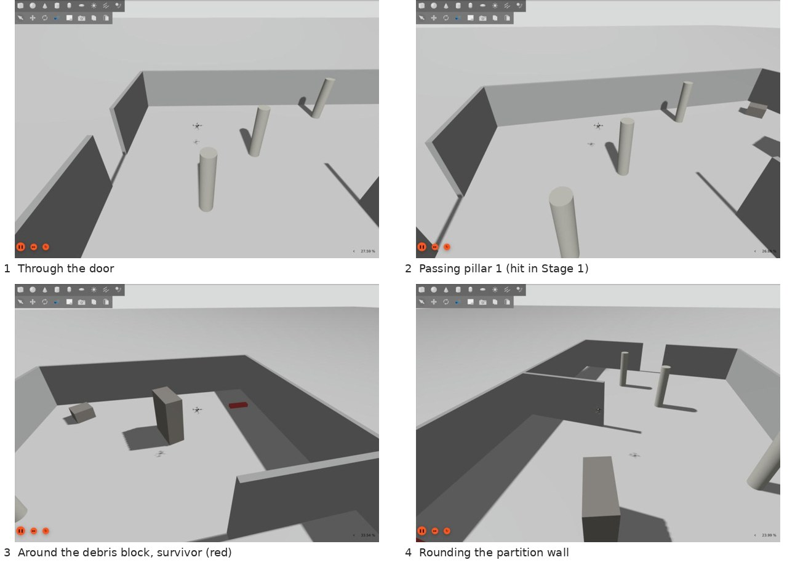
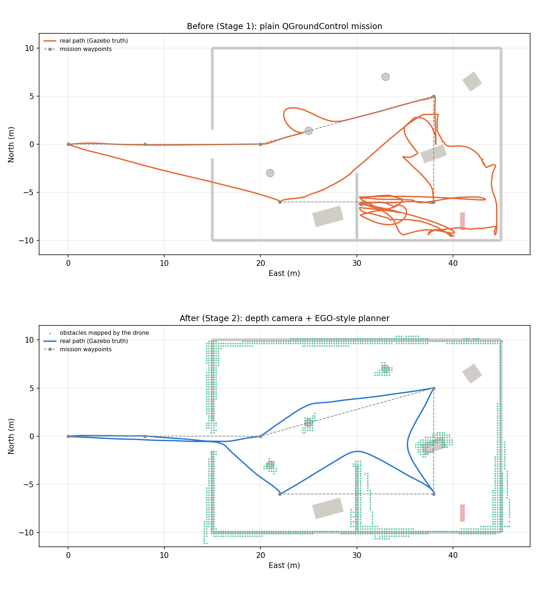
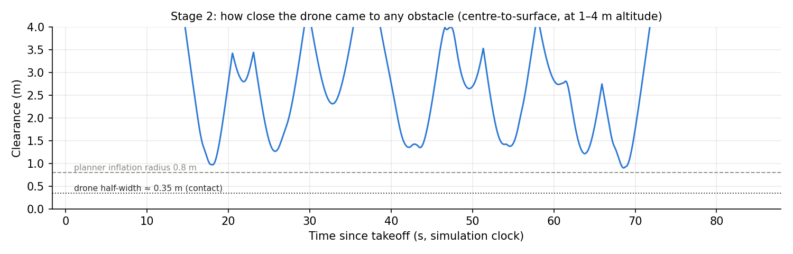
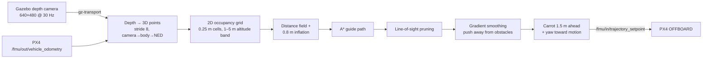
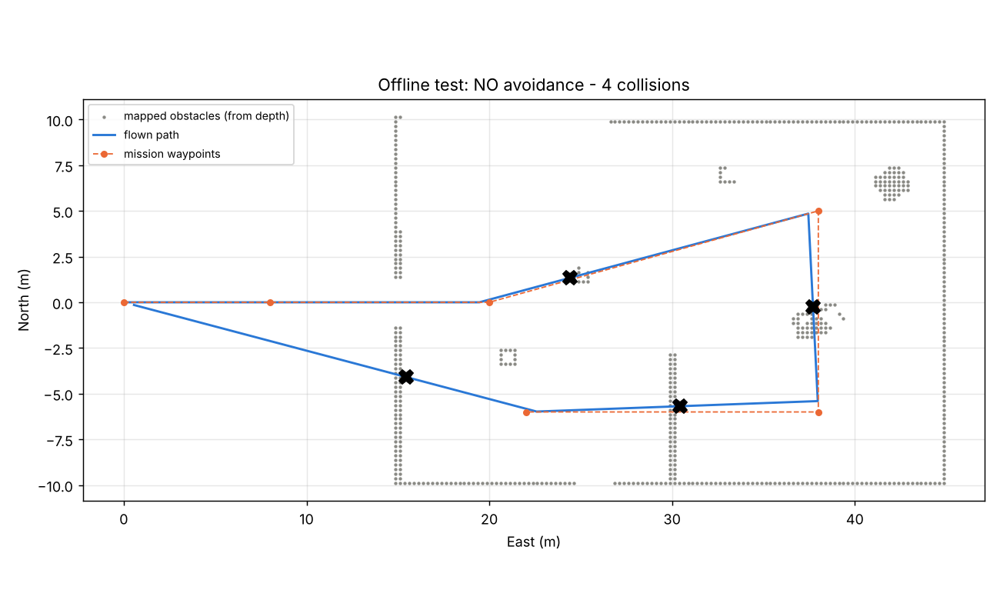
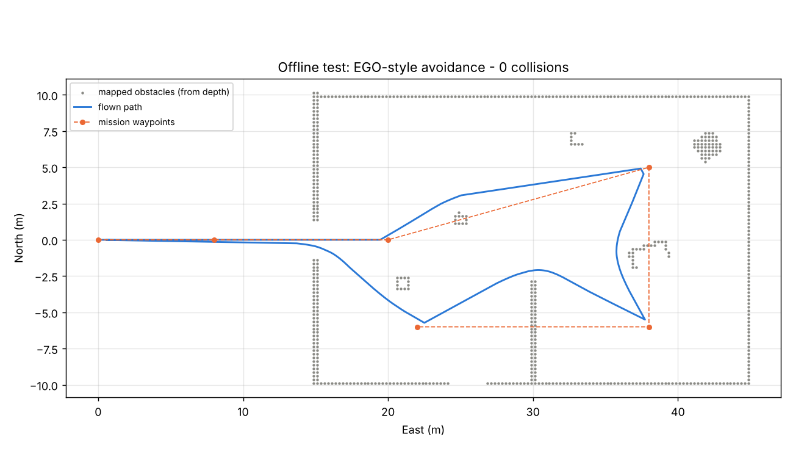

# Stage 2: Depth-camera obstacle avoidance (ROS2 + PX4 offboard)

**Date:** 12 Oct 2026  **Status:** ✅ Done — same mission, **0 collisions** (Stage 1: 3)

## Goal

Fly the exact Stage 1 mission through the damaged building — same waypoints, same 3 m altitude — but let the drone see with its depth camera, map obstacles, and plan around them by itself.



## Result in one figure



*Top: Stage 1 (run 4) — plain mission, real path from Gazebo ground truth, three impacts and 31 s of tumbling. (The long straight line back to the start is the RTL return at 30 m, above the walls.) Bottom: Stage 2 — same mission flown by our ROS2 node. Green dots: the obstacle map the drone built from its own depth camera during the flight.*

| | Stage 1 (run 4) | **Stage 2** |
|---|---|---|
| Collisions (IMU spikes > 20 g) | 3 | **0** |
| Closest approach to any obstacle (centre → surface) | 0.11 m (contact) | **0.90 m** |
| Max tilt | 126° (tumbling) | **13.9°** |
| Max position-estimate error vs truth | 2.8 m | **0.27 m** |
| Max true horizontal speed | 9.8 m/s (flung) | 1.5 m/s (commanded) |
| Takeoff → home | 88.5 s + RTL | 95.5 s incl. return through the building |
| Mission completed + landed at home | yes (after recovering) | **yes, cleanly** |

Clearance to each obstacle during the Stage 2 flight (ground truth): pillar 1 **1.27 m**, debris block **1.35 m**, partition **1.38 m**, pillar 3 **1.21 m**, west wall (doorway) **0.90 m**.



*The drone never got inside the planner's 0.8 m safety margin (dashed). Contact would require < 0.35 m (dotted).*

## How it works



| Piece | What it does | Why |
|---|---|---|
| **Perception** (`DepthProjector`) | Every 8th pixel of the depth image → 3D point, transformed with the drone's pose into the world (NED) | 4,800 points/frame is plenty for 0.25 m cells and runs at 10 Hz in Python |
| **Mapping** (`OccupancyMap2D`) | Keeps only points 1–5 m above ground (ignores floor and anything the drone flies over), counts hits per cell, ≥ 2 hits = obstacle | Simple, robust to noise; static world assumption |
| **Safety margin** | Distance field from every cell to the nearest obstacle; cells closer than 0.8 m are forbidden | Drone half-width ≈ 0.35 m + 0.45 m margin for tracking error |
| **Planner** (`EgoStylePlanner`) | If the straight line to the goal is free → fly it. Otherwise: A* on the grid (guide path) → prune → gradient descent that pulls the path smooth *and* pushes it away from obstacles | This is the core idea of **EGO-Planner** (Zhou et al., 2021): a collision-free guide path plus an optimiser that trades smoothness against clearance — implemented here in a lightweight 2D form |
| **Replanning** | 5 Hz; replans when newly mapped obstacles block the current path | The camera only sees ~73° ahead, so the map grows as the drone flies (47 replans this flight) |
| **Yaw-first turning** | If the new direction is > 40° off the camera heading, rotate on the spot before moving | The drone never flies toward something its camera hasn't looked at |
| **Mission logic** (`MissionFollower`) | Waypoints from the same QGroundControl `.plan` → home → land | Same mission as Stage 1 for a fair comparison |

Code: [`ros2_ws/src/lostlink_planner/lostlink_planner/core.py`](../ros2_ws/src/lostlink_planner/lostlink_planner/core.py) (algorithm, no ROS) and [`avoid_mission_node.py`](../ros2_ws/src/lostlink_planner/lostlink_planner/avoid_mission_node.py) (ROS2 + PX4 + Gazebo glue).

### PX4 interface

| Direction | Topic | Message |
|---|---|---|
| in | `/fmu/out/vehicle_odometry` | `VehicleOdometry` (position NED, quaternion) |
| in | `/fmu/out/vehicle_status_v4` | `VehicleStatus` v4 (armed? offboard?) |
| out | `/fmu/in/offboard_control_mode` | position control, streamed at 20 Hz |
| out | `/fmu/in/trajectory_setpoint` | position + yaw |
| out | `/fmu/in/vehicle_command` | set OFFBOARD (176), arm (400), land (21) |

The node does the whole flight itself: stream setpoints → switch to OFFBOARD → arm → take off to 3 m → mission → home → land.

## Development process

### Step 2.1 — Environment check (`sim/scripts/check_stage2_env.sh`)

Started PX4 headless and listed what exists. Findings (`results/stage2/env_check.txt`):

- Depth camera on Gazebo topic `/depth_camera`: `gz.msgs.Image`, 640×480, `R_FLOAT32`, 30 Hz; horizontal FOV 1.274 rad (73°), range 0.2–19.1 m; mounted 0.12 m forward, 0.24 m up.
- PX4 v1.18 publishes **versioned** ROS2 topics (e.g. `vehicle_status_v4`) → the existing `px4_msgs` from September would not match. `setup_stage2.sh` now builds `px4_msgs` straight from the local PX4 source, so they always match.
- Gazebo's Python bindings (`gz.transport13`) are installed → the node reads the depth camera **directly**, no ROS–Gazebo bridge to install.

### Step 2.2 — Offline test bench (`sim/offline/offline_sim.py`)

Before touching the laptop, the planner was tested in a minimal simulator: the same building geometry, a ray-cast depth camera with the same resolution/FOV/mount, and a simple drone model. It runs the **same `core.py`** as the ROS2 node.

| Offline test | Result |
|---|---|
| No avoidance | 4 collisions — pillar 1 at t = 18.7 s (real PX4: 19.1 s), debris, partition, west wall |
| Avoidance | **0 collisions**, mission complete in 70 s |
| + 2 % / 5 % depth noise | 0 / 0 |
| Depth convention flipped (range vs planar) | 0 |
| 2.5 m altitude, 3 m/s cap | 0 / 0 |




The path predicted offline is almost identical to what PX4 later flew in Gazebo — the bench is a reliable way to test changes in seconds instead of minutes.

### Step 2.3 — First real flight

1. **Crash before take-off:** the node crashed on its first map update — on this laptop, NumPy 2.2 is installed but the system SciPy was built for NumPy 1.x. **Fix:** replaced the one SciPy call (Euclidean distance transform) with a pure-NumPy version; checked identical to SciPy within 5×10⁻⁸ m, 15 ms per update.
2. **Second launch: full success** — the run in this page.

## How to run

```bash
bash sim/scripts/setup_stage2.sh          # once: builds px4_msgs + lostlink_planner in ~/lostlink_ws
bash sim/scripts/run_stage2.sh avoid      # PX4 + Gazebo + agent + QGC + node; results/stage2/run_<date>_avoid/
bash sim/scripts/run_stage2.sh noavoid    # same node, avoidance off (baseline)
```

Analysis (needs a Python with matplotlib that works with your NumPy):

```bash
python3 sim/scripts/flight_report.py <log.ulg> --stage stage2/<run>
python3 sim/scripts/stage2_report.py --before _archive/stage1_run4_flight.ulg --after _archive/stage2_<run>.ulg --run-dir results/stage2/<run>
```

## Limitations (honest list — engineers will ask)

1. **2D map at one altitude band.** Obstacles are flattened between 1 and 5 m; the drone does not fly over or under things. Fine for a building at fixed height, not for 3D clutter.
2. **Static world.** Hits only accumulate; a moving person or a door closing would not be cleared from the map.
3. **GPS still on.** Position comes from PX4's GPS-aided estimate (error ≤ 0.27 m). In Stage 3 GPS is denied and the map will be built on a drifting pose — that is the real test.
4. **Map smear.** Wall edges in the map are 0.25–0.75 m thicker than reality (visible in the figure), most likely from small timing offsets between depth image and pose. Harmless here thanks to the margin, but worth fixing (timestamp matching) before Stage 3.
5. **One run, one building.** Results are from a single flight. The Stage 4 evaluation needs many runs in randomised layouts for statistics.
6. **Slow sim on this laptop.** Real-time factor ≈ 25–40 % (no GPU in WSL), so a 95 s flight takes ≈ 4 min.

## Files

| File | What it is |
|---|---|
| `ros2_ws/src/lostlink_planner/` | ROS2 package: `core.py` (algorithm), `avoid_mission_node.py` (node) |
| `sim/offline/offline_sim.py` | Offline test bench |
| `sim/scripts/check_stage2_env.sh`, `setup_stage2.sh`, `run_stage2.sh` | Environment check, build, flight |
| `sim/scripts/stage2_report.py` | Before/after + clearance figures |
| `results/stage2/run_1012_1347_avoid/` | The successful flight: planner log, map, PX4 flight report, metrics, figures |
| `results/stage2/offline/` | Offline bench figures |
| `media/stage2/` | Gazebo screenshots from the flight |
| `stage2_run_1012_1347_avoid.ulg` (GitHub Release `stage2`) | Full PX4 log |

## Next

**Stage 3:** deny GPS at the doorway (PX4 failure injection), let the position estimate drift, and see what that does to the map and the avoidance — then Stage 4: the return-home decision.
