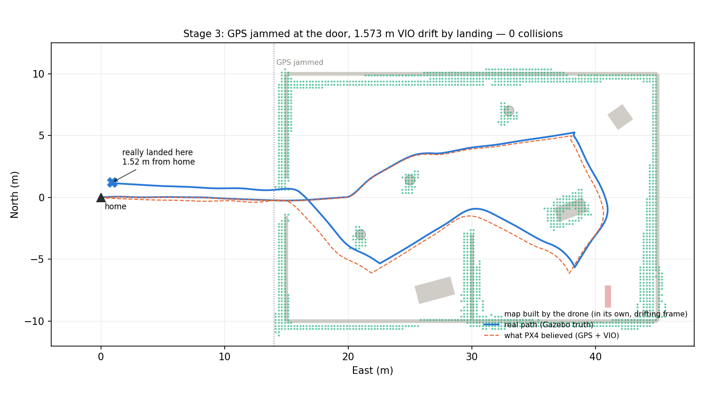
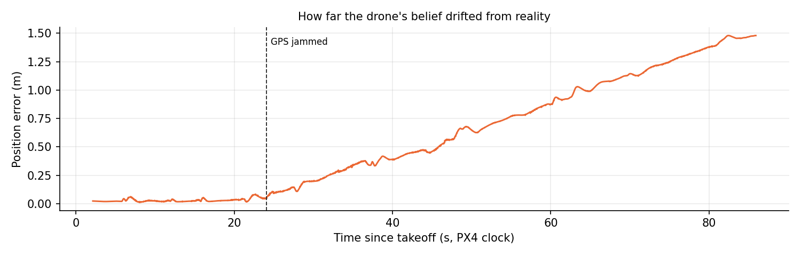
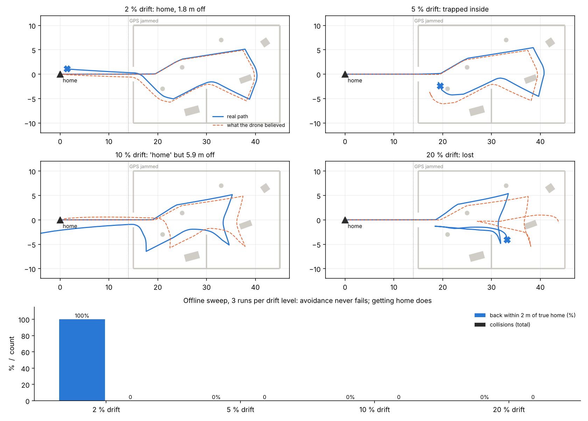
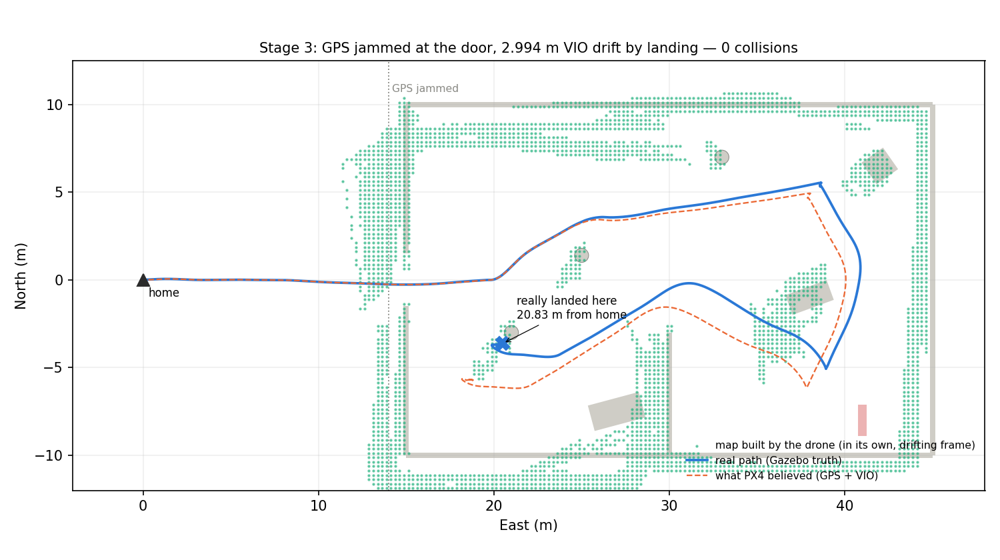
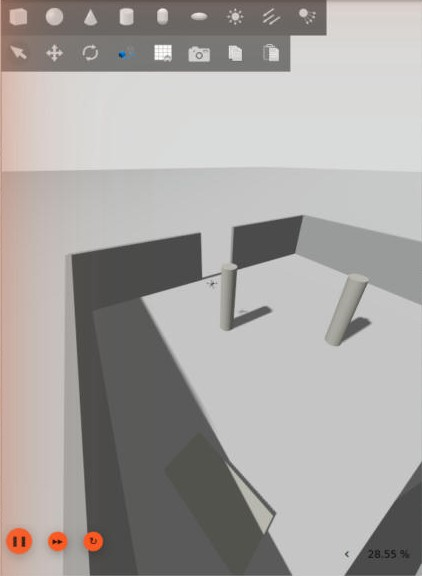

# Stage 3: GPS jammed at the doorway (drifting VIO)

**Date:** 12 Oct 2026  **Status:** ✅ Done (first pass): 3 real flights (2 %, 2 % repeat, 5 %) plus 12 offline runs. More seeds will come with Stage 4.

## Goal

Same mission as Stages 1–2, but GPS is **jammed when the drone reaches the doorway**. From then on it must fly on visual-inertial odometry (VIO), whose position error grows with distance flown. Question: **what breaks first — avoidance, or getting home?**

## Key result so far



*Real PX4 + Gazebo flight. GPS jammed at East = 14 m. Blue: real path (Gazebo truth). Orange dashed: what PX4 believed. Green: the map the drone built — note the walls appear **doubled** (north and west), because the same wall was seen from slightly different believed positions. The drone believed it landed on the home point; it really landed **1.52 m** away.*



*Position error stays near zero while GPS works, then grows steadily from the moment of jamming — the signature of VIO drift.*

| Real flight (2 % drift, seed 0) | Value |
|---|---|
| GPS jammed | t = 24.1 s after takeoff, East = 14.0 m |
| Mission | completed, all waypoints + return + landing |
| Collisions | **0** (min clearance 0.80 m) |
| VIO drift injected by landing | 1.57 m |
| PX4 estimate error at landing | 1.48 m (PX4 follows the VIO, as intended) |
| **True landing point vs home** | **1.52 m off** — the drone *thinks* it is home |

### Offline drift sweep (12 runs)



| VIO drift | Back within 2 m of true home | Collisions | What went wrong |
|---|---|---|---|
| 2 % | **3/3** (0.8–1.8 m off) | 0 | — |
| 5 % | 0/3 | 0 | 2 runs **trapped inside** (doubled walls closed the doorway in the map); 1 landed 2.7 m off |
| 10 % | 0/3 | 0 | 2 trapped; 1 "home" but really **5.9 m** off |
| 20 % | 0/3 | 0 | lost |

The real 2 % flight (1.52 m off) falls inside the offline prediction (0.8–1.8 m).

### Real flights so far (PX4 + Gazebo)

| Run | VIO drift | Outcome | Truly landed from home | Estimate error at end | Collisions | Min clearance |
|---|---|---|---|---|---|---|
| `run_1012_1449_d2_s0` | 2 % | ✅ home, believed on target | 1.52 m | 1.48 m | 0 | 0.80 m |
| `run_1012_1455_d2_s0` (repeat) | 2 % | ✅ home, believed on target | 1.37 m | 1.48 m | 0 | 0.83 m |
| `run_1012_1503_d5_s0` | 5 % | ❌ **trapped inside**, timed out after 15 min, landed in place | **20.83 m** | 2.70 m | 0 | **0.39 m** |

The 2 % result repeats (1.52 m vs 1.37 m). The 5 % flight matches the offline prediction: **trapped**.



*5 % drift, real flight. All 5 waypoints reached, then on the way home the planner found **no path**: in the drone's drifting map the west wall is drawn twice (≈ 2.5 m apart) and the doorway around East 12–15 m is filled with points. It hovered for 15 minutes (`mode=no_path`) and then landed where it was, 20.8 m from home.*



*Gazebo view while trapped: the drone hovers next to the pillar at (21, −3).*

**Findings:**

1. **Drift destroys the way home before it destroys avoidance.** At 2 % the drone gets home but is confidently ~1.5 m off. At 5 % the doorway closes in its own map and it is trapped, in the real simulator as well as offline.
2. **New, from the real 5 % flight: drift also eats into the safety margin.** The drone hovered where it *believed* it had a 1.2 m safety distance, but it was really 2.7 m from where it thought, only **0.39 m** from the pillar. No collision, but less than half the margin of the 2 % runs. The offline sweep did not show this; drift does not *cause* collisions here, but it shrinks real clearance without the drone knowing.
3. Both point to the Stage 4 idea: the drone needs to know **how much it can still trust its own position**, and turn back (or widen its margins) *before* the doorway disappears from its map.

## How it works

### Why VIO, and why simulated

With GPS gone and nothing else, PX4's estimator dead-reckons on the IMU and declares its position invalid within seconds → failsafe (land / altitude hold). Real indoor drones keep flying on **visual-inertial odometry** (camera + IMU), which works but **drifts**. Drift is the research variable here, so we need to *control* it.

`sim_vio` node: takes the drone's true pose from Gazebo (`/world/sar_building/dynamic_pose/info`), adds drift, and sends it to PX4 as external vision on `/fmu/in/vehicle_visual_odometry` — the same interface OpenVINS, VINS-Fusion or a T265 would use. PX4's EKF2 fuses it (`EKF2_EV_CTRL = 5`: horizontal position + velocity).

**Drift model** (starts when GPS is jammed): drift magnitude grows by `drift_pct` % of distance flown, in a direction that wanders slowly (random walk on heading) — the typical shape of real VIO error growth. Seeded, so runs are repeatable.

### GPS jamming

The mission node sends PX4's own failure-injection command (`VEHICLE_CMD_INJECT_FAILURE`, unit GPS = 4, type OFF = 1) the moment the estimated position crosses East = 14 m (just before the door). Verified in the environment check: GPS data stops and the estimator stops fusing GNSS.

### Settings changed for Stage 3 (`run_stage3.sh`)

| Parameter | Value | Why |
|---|---|---|
| `SYS_FAILURE_EN` | 1 | allow failure injection |
| `EKF2_EV_CTRL` | 5 | fuse VIO horizontal position + velocity |
| `EKF2_HGT_REF` | 0 (baro) | was 1 (GPS) — height would disappear with GPS |
| `NAV_DLL_ACT` | 0 | was 2 (RTL on ground-station link loss) — Stage 4 handles comms loss itself |

## Development log (problems and fixes)

1. **Environment check** (`check_stage3_env.sh`, report in `results/stage3/env_check.txt`): ground-truth pose topic found; GPS failure injection works in this SITL (`sensor_gps` stops, estimator switches to dead reckoning); found `EKF2_HGT_REF = 1` and `NAV_DLL_ACT = 2` (changed, see above).
2. **Clock mismatch (and the Stage 2 map smear):** PX4 stamps messages with **wall-clock** time, Gazebo stamps images with **simulation** time, and the sim runs at ~30 % real-time. Built a converter from Gazebo's clock topic and a pose buffer to look up the pose at each image's capture time.
3. **First version of the converter was wrong:** Gazebo's clock arrives only every few seconds of wall time and a 2-point slope extrapolated badly — some frames were mapped with poses up to 15 s old, painting fake walls across the doorway; the drone tried to fly **around the outside** of the building. Aborted the flight. **Fix:** least-squares real-time-factor over a 10 s window + reject any frame whose computed capture time is > 1 s from now (then use the latest pose, as in Stage 2). Unit-tested to ±0.06 s on jittery data.
4. **Still mostly fallback:** in the real run only ~10 % of frames could be time-matched (clock messages too sparse); the rest used the latest pose. Safe (Stage 2 behaviour), but the smear fix is not done yet — see limitations.
5. **VIO node crashed at start:** ROS2 refused `drift_pct:=2` (integer) for a float parameter → script now always passes floats.
6. **Leftover Gazebo blocked the next start** (`gazebo already running`) → run script now force-kills and verifies all old PX4/Gazebo/node processes.

## How to run

```bash
bash sim/scripts/check_stage3_env.sh            # optional: environment check
bash sim/scripts/run_stage3.sh 2 0               # drift 2 %, seed 0, GPS jammed at East > 14 m
python3 sim/scripts/stage3_report.py --log _archive/stage3_<run>.ulg --run-dir results/stage3/<run>
python3 sim/offline/drift_sweep.py               # offline sweep (no PX4/Gazebo)
```

## Limitations (so far)

1. **Simulated VIO, not a real one.** Drift magnitude and shape are a model. Upside: controlled, repeatable; downside: real VIO also fails in texture-less scenes, has scale drift and jumps. Next step for realism: OpenVINS on the simulated camera.
2. **Yaw is not drifted** (heading still from the magnetometer). Real VIO drifts in yaw too, which makes position error grow faster far from the start.
3. **Depth/pose time matching works for only ~10 % of frames** — the remaining smear (0.25–0.75 m) is still present. Better fix: subscribe to the high-rate `/clock` topic, or get the pose from the same Gazebo message stream as the image.
4. **Few runs.** Real: 2 × 2 % and 1 × 5 % (one seed). Offline: 3 seeds per drift level. Stage 4 needs ≥ 10 per condition for statistics.
5. **The trapped drone just hovers until the timeout.** That is the "no return logic" baseline on purpose. Stage 4 replaces it.

## Next

1. **Stage 4:** the return-decision layer — estimate "can I still get home?" from drift growth + the map's doorway, and turn back *before* the way home is lost.
