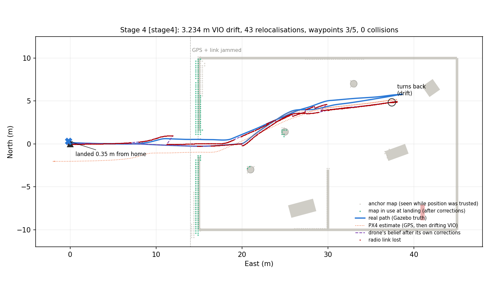
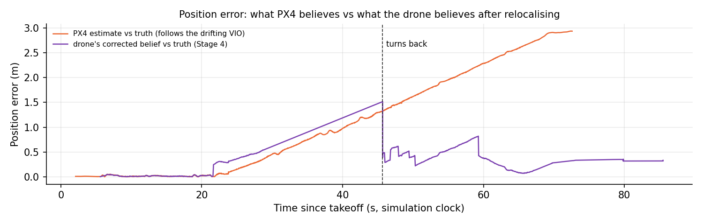
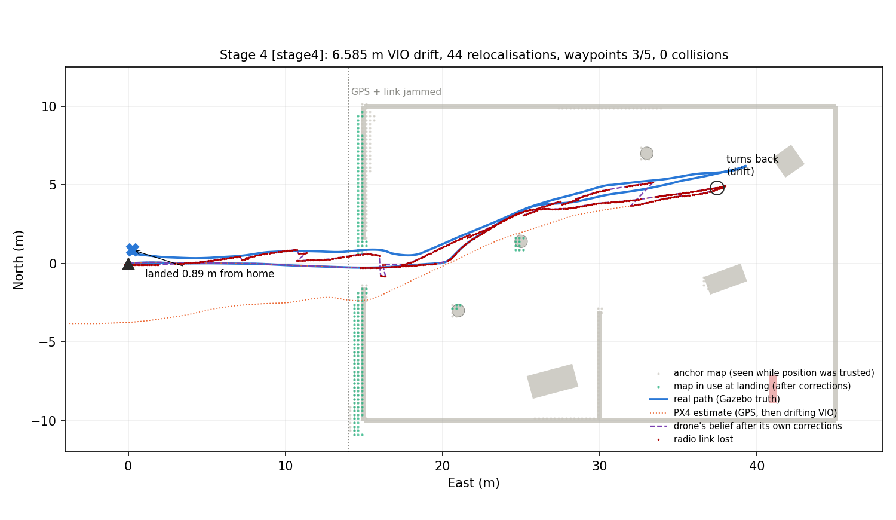
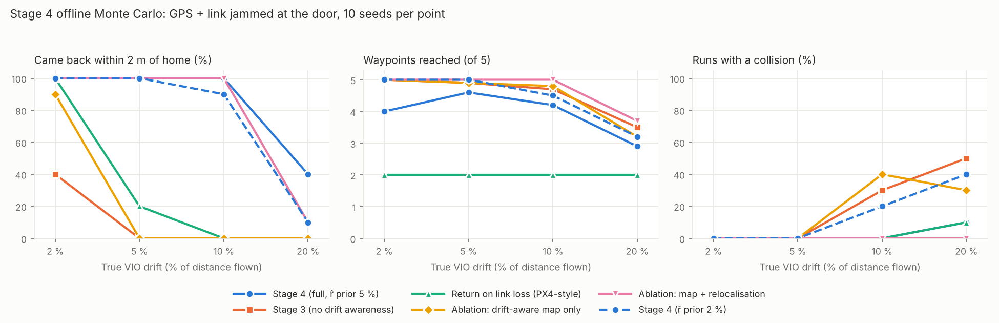

# Stage 4: knowing when to turn back (GPS + radio link jammed)

**Date:** 12 Oct 2026  **Status:** ✅ Done (first version): 4 real PX4 + Gazebo flights, 240 offline runs (6 policies × 4 drift levels × 10 seeds)

## Goal

Stage 3 showed that once GPS is jammed, drift does not break obstacle avoidance. It breaks **the way home**: the doorway disappears from the drone's own map (trapped), or the drone lands confidently metres from home. It also showed a hidden danger: the drone hovered **0.39 m** from a pillar while it believed it was safely clear.

Stage 4 is the full **Lost-Link** scenario: at the doorway the jammer takes **GPS and the radio link**. No operator can call the drone back, so it must decide **by itself** how far it can go and when to turn back, and still get home.

## Key results

### Real PX4 + Gazebo flights (5 % and 10 % VIO drift, GPS + link jammed at East = 14 m)



*Real flight, 5 % drift. Blue: real path (Gazebo truth). Orange dotted: PX4's estimate, which follows the drifting VIO and ends **2.9 m** off. Purple dashed: what the drone believes after its own corrections. Grey: the **anchor map** (seen while the position was still trusted). Green: the map in use at landing, now lined up with the real walls. After 3 waypoints the drone decided the next one would take it beyond what it could safely come back from, turned back, relocalised against the doorway, and **landed 0.35 m from home**.*



*Same flight. PX4's error (orange) keeps growing with distance flown. The drone's corrected belief (purple) drops back each time it recognises a part of the building it mapped with GPS. One honest detail: between ~22 s and ~45 s an early 0.25 m correction made the purple line slightly worse than PX4's own estimate.*

| Real flight | Drift | Waypoints | Why it turned back | PX4 estimate error at end | Drone's corrected error at end | **Landed from home** | Collisions | Min clearance |
|---|---|---|---|---|---|---|---|---|
| Stage 3 `run_1012_1503_d5_s0` (for comparison) | 5 % | 5/5 | – (no return logic) | 2.70 m | – | **20.83 m (trapped 15 min)** | 0 | 0.39 m |
| Return on link loss `run_1012_1631_rtl_link_d5_s0` | 5 % | 2/5 | link lost | 0.97 m | – | 0.74 m | 0 | 1.24 m |
| **Stage 4** `run_1012_1618_stage4_d5_s0` | 5 % | 3/5 | predicted drift | 2.93 m | 0.33 m | **0.35 m** | 0 | 0.98 m |
| **Stage 4** `run_1012_1635_stage4_d5_s1` (other seed) | 5 % | 3/5 | predicted drift | 2.85 m | 0.58 m | **0.52 m** | 0 | 0.79 m |
| **Stage 4** `run_1012_1627_stage4_d10_s0` | 10 % | 3/5 | predicted drift | 5.99 m | 0.94 m | **0.89 m** | 0 | 0.64 m |



*10 % drift: PX4's estimate ends 6 m off (orange), yet the drone lands 0.89 m from home.*

### Offline Monte Carlo (240 runs)

Same world, camera model and planner code as the real flights. GPS and link are jammed at the door, and each point is 10 random drift seeds.



| Policy | 2 % | 5 % | 10 % | 20 % |
|---|---|---|---|---|
| **Came back within 2 m of home** | | | | |
| Stage 3 (no drift awareness) | 40 % | 0 % | 0 % | 0 % |
| Return on link loss (PX4-style rule) | 100 % | 20 % | 0 % | 0 % |
| Ablation: drift-aware map only | 90 % | 0 % | 0 % | 0 % |
| Ablation: map + relocalisation | 100 % | 100 % | 100 % | 10 % |
| **Stage 4 (full)** | **100 %** | **100 %** | **100 %** | **40 %** |
| Stage 4 with an optimistic drift prior (2 %) | 100 % | 100 % | 90 % | 10 % |
| **Waypoints reached (of 5)** | | | | |
| Stage 3 | 5.0 | 4.9 | 4.7 | 3.5 |
| Return on link loss | 2.0 | 2.0 | 2.0 | 2.0 |
| Map + relocalisation | 5.0 | 5.0 | 5.0 | 3.7 |
| **Stage 4 (full)** | 4.0 | 4.6 | 4.2 | 2.9 |
| **Runs with a collision** | | | | |
| Stage 3 | 0 % | 0 % | 30 % | 50 % |
| Map + relocalisation | 0 % | 0 % | 0 % | 0 % |
| **Stage 4 (full)** | 0 % | 0 % | 0 % | 10 % |
| Stage 4, optimistic prior (2 %) | 0 % | 0 % | 20 % | 40 % |

Full table (median landing error, timeouts, every policy): [results/stage4/offline/summary.md](../results/stage4/offline/summary.md). Raw runs: `results/stage4/offline/runs.jsonl`.

### What we learned

1. **Recognising the building is what brings the drone home.** Matching what it sees against the anchor map (the part mapped while GPS still worked) takes safe returns from **0 % to 100 %** at 5 % and 10 % drift. A drift-aware map on its own is not enough (0 % at 5 %).
2. **The return decision is a safety net for extreme drift, and it has a price.** Up to 10 % drift, relocalisation alone already gets every run home, so the decision only costs coverage (4.0–4.6 waypoints instead of 5). At 20 % drift relocalisation stops working, and the decision is the only thing that still helps: 40 % safe returns instead of 10 %. 60 % of those runs still fail, so this is not solved.
3. **Underestimating drift is dangerous.** With an optimistic 2 % prior, the drone goes further and then **scrapes the door frame** on the way out (collisions at 10–20 % drift, almost all with the west wall next to the door). The conservative 5 % prior plus learning the rate in flight avoids this up to 10 %.
4. **The "fly home when the link drops" rule is safe only at low drift.** It turns back right after the door (2 of 5 waypoints). At 5 % drift and above it still gets trapped half the time in the offline runs, because it uses the plain Stage 3 map. In its single real flight it got home (0.74 m off).
5. **Real flights agree with the offline bench**, but the real drone is more conservative: it turned back after waypoint 3 every time, while offline it often relocalised mid-mission and continued. Likely cause: with only ~10 % of depth frames time-synced in Gazebo (Stage 3 limitation), the mid-mission matches are weaker.

## How it works

Code: [`ros2_ws/src/lostlink_planner/lostlink_planner/stage4.py`](../ros2_ws/src/lostlink_planner/lostlink_planner/stage4.py). It has no ROS dependency, so the real node and the offline bench run exactly the same code.

### 1. Drift-aware map

Every map cell remembers *when* it was last seen, measured in metres flown without GPS. Cells not seen again within a window **W = e_tol / r̂** are ignored. With e_tol = 0.4 m and an assumed drift rate r̂ = 5 %, W = 8 m. So everything the planner uses was seen from poses that drifted less than ~0.4 m relative to each other. This is the cure for the Stage 3 "doubled walls". Cells within 1.5 m of the drone are kept a little longer (up to 2W) for safety.

### 2. Anchor map + relocalisation

While the position is still trustworthy (GPS, plus the first ~4 m after jamming), every observation also goes into a separate **anchor map**: the outside of the building, the doorway, and what the camera saw inside through the door. Once a second, the drone matches its last ~4 m of depth observations against the anchor map. This is a 2D correlative scan match, searching translations within ±min(3σ + 0.5, 5) m. A match is accepted only if it scores ≥ 0.55, is clearly better than no shift, and is **unique** (no other peak more than 1 m away scores nearly as well). The accepted shift is the measured drift. The drone corrects its own belief and moves its map by the same amount, but sends setpoints to PX4 in PX4's own (drifting) frame.

Every accepted match also **measures the drift rate** (shift ÷ distance flown since the last fix). The drone raises r̂ if the measurement is higher, and never lets it fall below the prior.

### 3. Breadcrumbs home

The drone keeps a graph of where it has actually flown (GBPlanner-style). On the way back it plans straight to the exit through its current map. If that makes no progress for 20 s, it follows the breadcrumbs instead.

On the last leg outside the building there is nothing new to see, so the drone **flies backwards with the camera on the facade** it mapped with GPS and keeps relocalising until touchdown. This alone cut the landing error at 10 % drift from ~2.5 m to ~1.1 m in the first tests.

### 4. The return decision (the novelty)

Before and during every leg, the drone predicts its position uncertainty at the moment it would be back at the exit, where it can recognise the building again:

```
sigma_exit = sigma_fix + r̂ · ( s − s_fix  +  d(p, wp)  +  L_ret(wp) )
L_ret(wp)  = min( d(p, wp) + L_exit(p),  κ · |wp − exit| )        κ = 1.25 (detour factor)
```

- `s − s_fix`: metres flown since the last successful relocalisation (σ_fix = 0.3 m after a match).
- `L_exit(p)`: the known way back to the exit (breadcrumb graph).

It goes on to the next waypoint only if:

| Check | Limit | Meaning |
|---|---|---|
| sigma_exit ≤ **capture radius** | 3.0 m | it will still be able to recognise the exit |
| σ_fix + r̂ · L(exit→home) ≤ **landing budget** | 2.0 m | it can still land close enough to home |
| time to go there and come home + reserve | ≤ endurance | battery (1200 s, 60 s reserve; never binding in these runs) |

If any check fails, it turns back **now**. The time to decide is before it goes out of reach, not when the battery is low or the link is gone.

### 5. Radio link model (`sim_link`)

The ground station sits at home. The link budget is: received power = 20 dBm − (40 + 20·log10 d) − 20 dB × (walls between drone and ground station), and the link is OK above −85 dBm. One wall is fine; two walls cut the link. In the Lost-Link scenario the jammer also takes the link from the moment GPS is jammed, which is how all results above were run.

The `rtl_link` policy is the conventional rule: return home 10 s after the link drops, like PX4's data-link-loss failsafe.

## Development log (problems and fixes)

1. **First design used only the drift-aware map + breadcrumbs.** At 5 % drift the breadcrumbs laid near the door before most of the drift pointed **~4 m away from the real door** by the time the drone came back, and it pushed against the wall. **Fix:** relocalisation against the anchor map.
2. **Retracing the whole loop:** the breadcrumb route home from the last waypoint went all the way back around the mission loop and then stalled. The route's "4 m ahead" point lay behind the drone. **Fix:** plan straight to the exit first, use breadcrumbs only when stuck; routes can start at any visible crumb (multi-source Dijkstra); subgoal = farthest visible point along the route.
3. **Phantom wall across the doorway:** after a relocalisation shift, old "forgotten" wall cells were shifted too, and the keep-close-cells safety rule brought them back across the door. **Fix:** drop forgotten cells when the map shifts; the close-range rule only keeps moderately old cells.
4. **The return decision never fired at 20 % drift** because the assumed 5 % was too low. **Fix:** learn the drift rate from the relocalisation shifts (a 20 % run learned ~17 % and turned back in time).
5. **Landing error dominated by the last 15 m outside**, where there is nothing new to recognise. **Fix:** fly backwards on the last leg, camera on the facade mapped with GPS.
6. **Monte Carlo too slow:** a trapped drone re-ran a whole-map A* search 10× per second. **Fix:** after a failed search, hover and look around for 1 s before trying again.
7. **Report clock mismatch:** the planner log is wall-clock and the PX4 log is simulation time (lockstep, slower than real time). **Fix:** align the two logs by position (each planner row recorded PX4's estimate), dropping rows that don't match cleanly (hovering + turning).

## How to run

```bash
# one-time: rebuild the ROS2 package (new nodes: sim_link; new module: stage4)
cd ~/lostlink_ws && colcon build --symlink-install --packages-select lostlink_planner

# real flight: policy, drift %, seed, [jam East m], [r_hat prior]
bash sim/scripts/run_stage4.sh stage4 5 0
bash sim/scripts/run_stage4.sh rtl_link 5 0
python3 sim/scripts/stage4_report.py --log _archive/stage4_<run>.ulg --run-dir results/stage4/<run>

# offline (no PX4/Gazebo): one run with a plot, or the whole Monte Carlo + summary
python3 sim/offline/stage4_bench.py --policy stage4 --drift 10 --seed 0 --plot out.png
python3 sim/offline/stage4_bench.py --sweep --seeds 10 --r-hats 0.05,0.02
python3 sim/offline/stage4_sweep_report.py
```

## Limitations (honest list)

1. **Simulated VIO and simulated link.** Drift is a model (random-walk direction, no yaw drift, no failures in texture-less areas). The radio is a simple wall-count model, not a propagation simulation.
2. **One building, one mission.** The anchor map covers a large part of this small building (the camera sees far inside through the door). In a deeper building, relocalisation would be possible less often, and the return decision would matter more. That has to be tested.
3. **The drift-rate estimate is biased low** when the drone relocalises often: each correction smaller than one map cell (0.25 m) is discarded. In the real 10 % flight (true rate ≈ 9.7 %) it learned only 5–6 %. It never goes below the prior, so the decision stays at least as careful as the prior, but at 20 % drift this is the main reason for the remaining failures. A longer-baseline estimator is next.
4. **Translation-only relocalisation** (yaw is not drifted in our VIO model). Real VIO drifts in yaw too.
5. **Few real flights:** 3 Stage 4 + 1 baseline. The offline bench carries the statistics; the real flights confirm the behaviour.
6. **Battery is a time budget** and never limited these runs.

## Next

1. Better drift-rate estimator (long baseline between relocalisations), then re-run the 20 % case.
2. A bigger, deeper building where the anchor map cannot see far inside, to test the decision when relocalisation is rare.
3. Yaw drift in the VIO model + rotation search in the matcher.
4. Paper: write-up of the method and the Monte Carlo (Stage 5).
