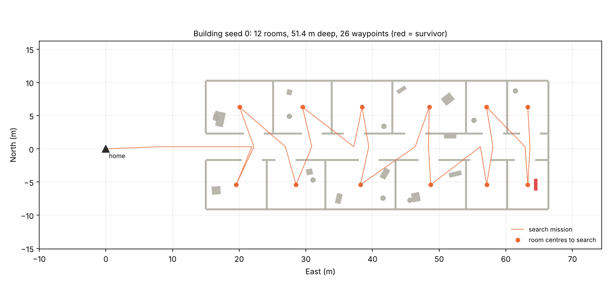
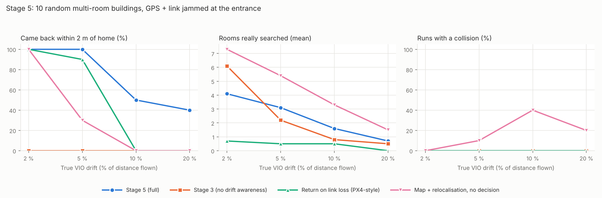
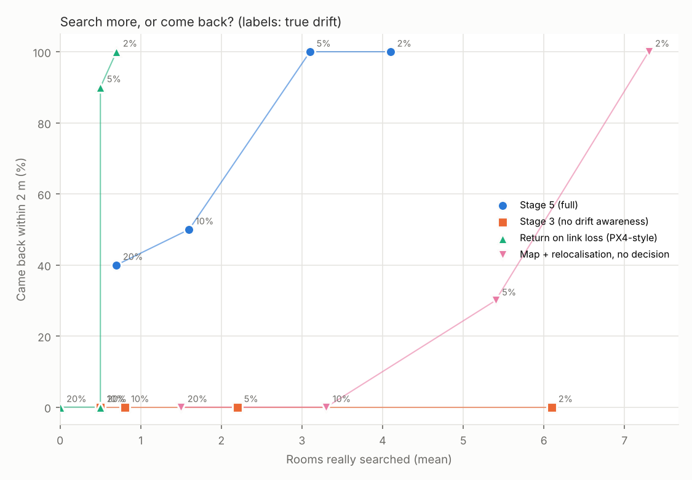
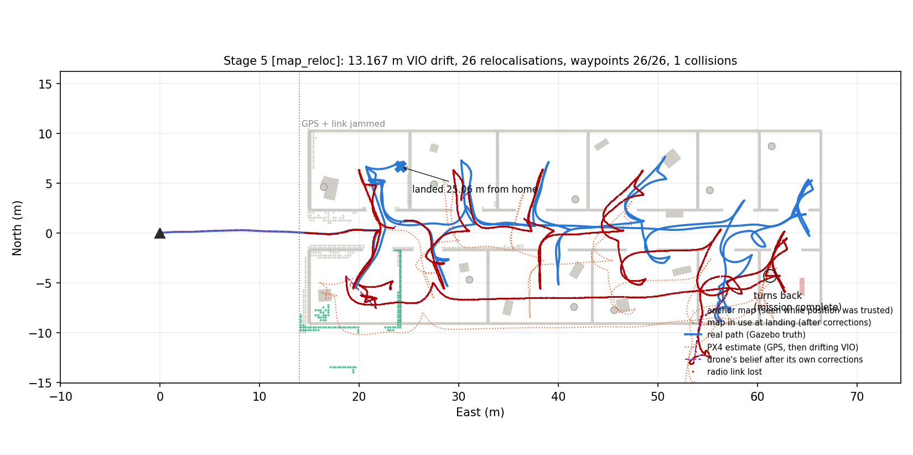
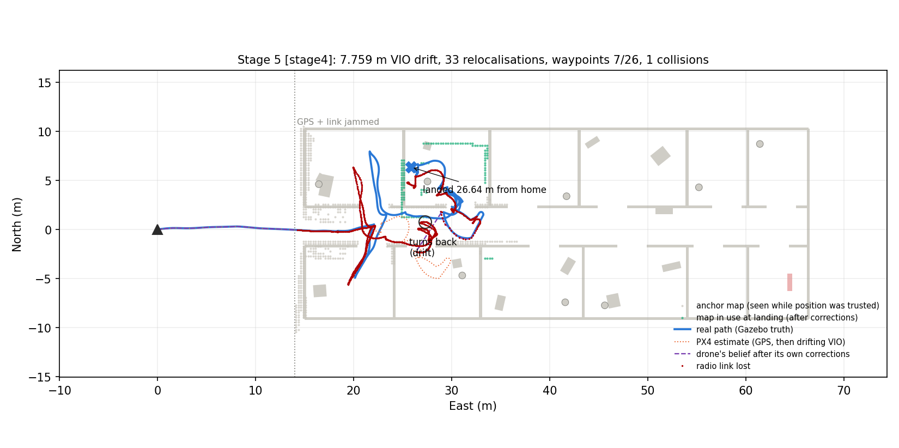
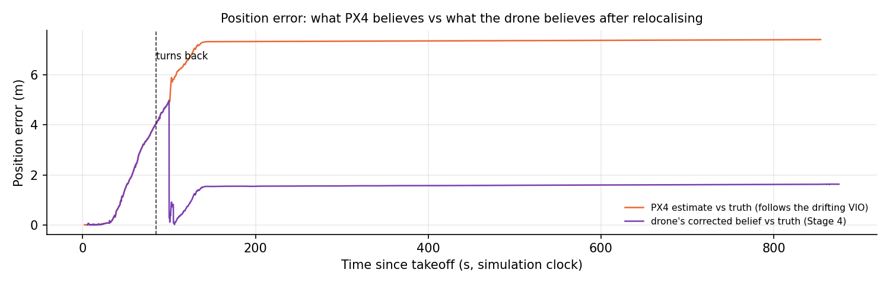

# Stage 5: random deep buildings: does the return decision earn its place?

**Date:** 13 Oct 2026  **Status:** ✅ Done (offline Monte Carlo, 400 runs) · ⚠️ real flights: 3 (1 safe return, 2 failures, analysed below)

## Why this stage

Stage 4 left an honest weak spot: in the small Stage 1 building, relocalisation almost always works, so the return decision only mattered at 20 % drift. A reviewer would ask whether the decision ever matters, and whether the method only works in one hand-made building.

Stage 5 answers both questions:
- **Random buildings.** A generator builds a new damaged multi-room building from each seed. This is the usual practice in navigation research: procedurally generated environments, so a method can't be tuned to one map.
- **Deeper buildings.** A 42–55 m corridor with 8–12 rooms. From the entrance the camera cannot see into the rooms, so deep inside there is nothing to recognise.

## Two kinds of simulation: offline bench and real simulator

| | **Real simulator** | **Offline bench** |
|---|---|---|
| What runs | PX4 autopilot + Gazebo physics and depth camera + ROS2 | a lightweight Python model of the same building, depth camera (ray casting) and drone motion |
| Drone software | `lostlink_planner` (ROS2 node) | **the same planning code** (`core.py`, `stage4.py`), without ROS |
| One flight takes | 5–30 min (Gazebo runs at ~30 % of real time) | 10 s – 2 min |
| Realism | real flight controller, physics, camera timing effects | ideal camera, simple motion model |
| Used for | showing the behaviour holds in a full autopilot + physics stack | statistics: hundreds of runs over drift levels, random seeds and buildings |

The Monte Carlo numbers on this page come from the offline bench (`sim/offline/stage5_sweep.py`, 400 runs, about 3 hours on a 2-core machine; anyone can reproduce them with one command). The real-simulator flights check that the same behaviour appears with PX4 and Gazebo in the loop. Where the two differ, this page says so.



*Building seed 0: 12 rooms off a 4 m corridor, debris and pillars in every room, a survivor (red) in one room. The search mission visits every room in order of depth. GPS and the radio link are jammed at the entrance (East = 14 m), as in Stage 4.*

## Key results

### Deep random buildings (10 buildings × 4 drift levels × 4 policies = 160 runs)



| Got home within 2 m | 2 % | 5 % | 10 % | 20 % |
|---|---|---|---|---|
| Stage 3 (no drift awareness) | 0 % | 0 % | 0 % | 0 % |
| Return on link loss (PX4-style rule) | 100 % | 90 % | 0 % | 0 % |
| Map + relocalisation, **no return decision** | 100 % | 30 % | 0 % | 0 % |
| **Stage 5 (full)** | **100 %** | **100 %** | **50 %** | **40 %** |

| Runs with a collision | 2 % | 5 % | 10 % | 20 % |
|---|---|---|---|---|
| Map + relocalisation, no return decision | 0 % | 10 % | 40 % | 20 % |
| **Stage 5 (full)** | **0 %** | **0 %** | **0 %** | **0 %** |
| Stage 3 / return on link loss | 0 % | 0 % | 0 % | 0 % |

| Rooms really searched (mean, of 8–12) | 2 % | 5 % | 10 % | 20 % |
|---|---|---|---|---|
| Return on link loss | 0.7 | 0.5 | 0.5 | 0.0 |
| Map + relocalisation, no return decision | 7.3 | 5.4 | 3.3 | 1.5 |
| Stage 3 | 6.1 | 2.2 | 0.8 | 0.5 |
| **Stage 5 (full)** | 4.1 | 3.1 | 1.6 | 0.7 |

*"Rooms really searched" counts rooms the drone truly entered (within 1.5 m of the room centre, by Gazebo-style ground truth), not waypoints it believed it reached.* Full table (survivor found, timeouts, landing error): [summary_buildings.md](../results/stage5/offline/summary_buildings.md).



*The trade-off in one picture. Points further right searched more rooms; points higher came back safely. Labels are the true drift. Without the decision (pink) the drone searches more rooms, but it stops coming back as soon as drift reaches 5 %. Flying home on link loss (green) is safe at low drift but searches almost nothing. Stage 5 (blue) stays safe at 2–5 % drift while still searching 3–4 rooms.*

### The original Stage 1 building, re-run with the final code (240 runs)

| Got home within 2 m | 2 % | 5 % | 10 % | 20 % |
|---|---|---|---|---|
| Stage 4 (first version, from the Stage 4 page) | 100 % | 100 % | 100 % | 40 % |
| **Stage 5 (final code)** | **100 %** | **100 %** | **100 %** | **20 %** |
| Waypoints reached, Stage 4 → Stage 5 | 4.0 → 4.8 | 4.6 → 4.8 | 4.2 → 5.0 | 2.9 → 3.4 |

The new drift-rate estimator lets the drone learn that its drift is *lower* than assumed, so it searches more (nearly the full mission up to 10 %). At 20 % drift it does worse than the first version (20 % vs 40 % safe returns). Full table: [summary_stage1.md](../results/stage5/offline/summary_stage1.md).

### What we learned

1. **In deep buildings the return decision is essential, not optional.** At 5 % drift it turns 30 % safe returns into 100 %, and at 10 % drift 0 % into 50 %. It also removes every collision: the drone without it hits walls in up to 40 % of runs, because it keeps flying long after its map has stopped lining up.
2. **The price is coverage.** At 2 % drift the decision gains no safety (both 100 %) but searches fewer rooms (4.1 vs 7.3). That is the cost of a conservative 5 % drift assumption, and it is the trade-off an operator should set.
3. **Flying home when the link drops is safe but useless.** It searches 0–0.7 rooms on average, and from 10 % drift it doesn't come back either.
4. **Remaining failures at 10–20 % drift have two clear causes:**
   - **Trapped deep inside (most failures).** Far from the entrance there is nothing to recognise, so the drone cannot learn that its drift is 10–20 % rather than the assumed 5 %. Its map slowly misaligns until a doorway closes, and it times out.
   - **Turned back in time, landed far away.** The recognition alarm made it turn back, but the drift was already too large for it to find the exit precisely (landed ~9–10 m off).

## What changed since Stage 4

All in [`stage4.py`](../ros2_ws/src/lostlink_planner/lostlink_planner/stage4.py), offline and ROS2 alike:

| Change | Why |
|---|---|
| **Building generator** [`make_building.py`](../sim/worlds/make_building.py) | One seed gives the same building for the offline bench, Gazebo (`.sdf`), QGroundControl (`.plan`) and the radio model (`.json`) |
| **Drift-rate estimator, long baseline** | The Stage 4 estimator rounded every small correction away and read 5–6 % when the truth was ~10 %. New: compare the total correction at two fixes ≥ 15 m of flight apart. It reads ~10.5 % at 10 % and ~2.5 % at 2 %, can go down as well as up, and never goes below 2 % |
| **Recognition alarm** | If the camera sees a part of the building that is in the anchor map but 5 matches in a row fit badly, the drone assumes 3× the drift (15 %). Ambiguous fits in corridors (good but not unique) don't count; that's geometry, not drift |
| **Skip stuck waypoints** | No progress towards a waypoint for 15 s → skip it (e.g. it lies inside an obstacle in the drone's slightly shifted map) |
| **Adaptive look-ahead** | Near walls the drone chases a point closer than 1.5 m along its path. This fixed door-frame scrapes caused by cutting the inside of tight corners |
| **Honest coverage metric** | Rooms counted from the true path, not from waypoints the drone believed it reached |

Real-simulator only ([`avoid_mission_node.py`](../ros2_ws/src/lostlink_planner/lostlink_planner/avoid_mission_node.py)):

| Change | Why |
|---|---|
| **Motion-gated mapping** | Depth frames are skipped while the drone turns faster than 0.25 rad/s. Frames placed with a slightly wrong pose during turns painted corridor walls up to 0.8 m inside their real position |
| **Forced disarm after 60 s in LAND** (simulation only) | With barometer height after GPS loss, PX4's land detector sometimes never fired with the drone on the ground |
| **Wider corridors and doors** (4.0 m / 3.0 m) | With 3.2 m / 2.6 m the noisier real depth map closed the entrance. The planner then routed outside the building and clipped an unseen corner (see log) |

## Real flights (PX4 + Gazebo, building 0)

| Run | Policy | VIO drift | Rooms really searched | Turned back because | Truly landed from home | Collisions | Min clearance | Drone's own position error at the end |
|---|---|---|---|---|---|---|---|---|
| `run_1013_1037_b0_stage4_d5` | Stage 5 (before adaptive look-ahead) | 5 % | 1 | recognition alarm | ✅ **0.64 m** | 0 | 1.06 m | 0.68 m |
| `run_1013_1044_b0_map_reloc_d5` | map + relocalisation, **no return decision** | 5 % | 7 of 12 | all waypoints done | ❌ **25.1 m** (timed out) | 1 | 0.09 m | 12.1 m |
| `run_1013_1444_b0_stage4_d10` | Stage 5 (final code) | 10 % | 2 | drift (recognition alarm) | ❌ **26.6 m** (timed out) | 1 | 0.38 m | 1.6 m |

**5 %, Stage 5:** entered, searched 1 room, turned back when the recognition alarm fired, and landed 0.64 m from home. PX4's own estimate was 1.9 m off; the drone's corrected estimate 0.68 m. Offline the same case searched 3 rooms: the real flight is more cautious because the noisier real depth map triggers the alarm earlier.

**5 %, no return decision (the baseline):** this is what the return decision is for.



*The drone searched the whole building (26 waypoints, 6 of them skipped after no progress) and flew 276 m without GPS. It relocalised 26 times, but only near the entrance, where it could see the walls it had mapped with GPS. Deep inside, nothing could be recognised and the VIO drift reached 13 m. At 157 s it hit the corridor wall at East ≈ 59 m (it believed it was 6–7 m away), dropped to 0.1 m and recovered. It then "returned" to a home that was 12 m away from the real one, hovered until the mission timeout and landed in the first room, 25 m from home. It did enter 7 rooms, but not the survivor's room. The offline bench predicted this: without the decision, 30 % safe returns at 5 % drift, and 10 % of runs collided.*

**10 %, Stage 5 (final code):** a failure, and an informative one.





1. **The decision worked.** After 2 rooms the recognition alarm fired and the drone turned back (`return: drift`, after waypoint 7 of 26).
2. **The return started with ~5 m of error.** At 100 s (simulation clock) it scraped the end of the corridor wall next to the second north door, dropped to 0.1 m and recovered. This is the only collision.
3. **Relocalisation then worked.** Seconds later it recognised walls it had mapped with GPS and corrected its position by 4.9 m; its error fell from 5 m to under 0.5 m. The drift-rate estimate was updated to 9.9–10.4 % (true: 10 %).
4. **Then it got stuck in the wrong room.** Instead of flying west along the corridor, it went through the door into the room north of the corridor and stopped 0.6 m from that room's west wall, the side nearest home. In its map the corridor west of the door looked narrower than it is (wall points mapped about 1 m inside the corridor), which is the likely reason the planner preferred the room.
5. **It hovered there for 26 minutes.** Its planned path ended at its own position, short of the next breadcrumb, which lay inside the 0.8 m safety margin of the wall. The target did not change, so it never re-planned. The return has no "no progress" rule (the 15 s skip rule only applies to search waypoints). It landed at the mission timeout, 26.6 m from home, while it knew where it was to within 1.6 m.

**What the real flights add to the offline numbers:**

- Without the return decision, the drone gets lost deep inside, in the real simulator too.
- With the decision, the 10 % failure is not a localisation failure. The drone knew where it was. It failed to **move** out of a dead end. That is the same weak spot as the offline "trapped" failures, and it makes the next fix concrete:
  - a no-progress watchdog during the return (re-plan, or skip to the next breadcrumb);
  - clearing the old map when stuck.
- The 10 % flight turned back with ~5 m of error and collided once. The offline bench at 10 % had no collisions. The real depth map and the real flight dynamics are less forgiving.

## Development log

1. **First real flight in a generated building:** the waypoint-skip timer started when the node launched, not when the mission started, so waypoints were skipped while still outside. Fixed (timer starts with the mission).
2. **No way in:** in Gazebo the corridor walls were mapped up to 0.8 m inside their real position (depth/pose timing smear while turning, the Stage 3 limitation). The 3.2 m corridor shrank to ~0.9 m in the map. **Fixes:** motion-gated mapping + wider corridors and doors.
3. **Crash (real simulator):** with the entrance closed in its map, the planner routed outside the building through unmapped space and clipped the north-west corner, which it had never seen from the side. The drone flipped. Run discarded and kept in `_archive/stage5_failed_runs/`. Root cause fixed by (2). The underlying risk (planning through unknown space treats it as free) remains a limitation.
4. **Door-frame scrapes (offline, 40 % of runs at 5 % drift in an early version):** corner cutting by the path follower plus ~0.4 m drift error. Fixed by adaptive look-ahead → 0 collisions.
5. **Clearance metric** counted flying *over* low debris as 0 m clearance. Fixed (only obstacles that reach the drone's altitude count).
6. **Slow Monte Carlo:** depth ray casting against ~60 boxes + distance maps took 53 ms per step. Out-of-range obstacles are now skipped, and the bench uses SciPy's exact distance transform (identical to the pure-NumPy version: max difference 0.0). That's 5.5× faster. A 10-minute compute cap per run was never needed in the final sweep.

## How to run

```bash
# a building (spec + picture); with --px4 also the Gazebo world and the QGC plan
python3 sim/worlds/make_building.py --seed 0 --plot
python3 sim/worlds/make_building.py --seed 0 --px4 ~/PX4-Autopilot

# real flight in generated building 0 (policy, drift %, building seed)
bash sim/scripts/run_stage5.sh stage4 5 0
python3 sim/scripts/stage4_report.py --log _archive/stage5_<run>.ulg --run-dir results/stage5/<run> \
    --world-spec sim/worlds/generated/building_0.json

# offline: one run, or the whole Stage 5 Monte Carlo (resumable) + summary
python3 sim/offline/stage4_bench.py --policy stage4 --drift 5 --seed 0      # Stage 1 building
python3 sim/offline/stage5_sweep.py
python3 sim/offline/stage5_report.py
```

## Limitations

1. **Offline bench vs real simulator:** the bench has no depth/pose timing smear. Real flights are more cautious (the recognition alarm fires earlier), and doors had to be widened for the real map.
2. **Drift deep inside cannot be learned.** With nothing to recognise, the drone relies on its assumed drift rate. If the truth is 2–4× higher, it can be trapped (most 10–20 % failures).
3. **Planning through unknown space** treats it as free. That caused one real crash around an unseen outside corner.
4. **One building family** (corridor + rooms). No stairs, no multi-floor, no moving obstacles.
5. **Simulated VIO** (drift model, no yaw drift) and a simple radio model, as in Stages 3–4.
6. **Real flights:** few (3 in generated buildings: 1 safe return, 2 failures). The statistics come from the offline bench.
7. **No escape when stuck during the return.** The real 10 % flight hovered for 26 min at a dead end next to a wall although its position estimate was good (see Real flights).

## Next

1. **Recovery when trapped:** a no-progress watchdog during the return (re-plan, or skip to the next breadcrumb), and after longer without progress, clear the old map and keep only the last few metres. That should reopen doors closed by misalignment and fix the real 10 % failure. Then re-run the Monte Carlo and the real 10 % flight.
2. Yaw drift in the VIO model + rotation search in the matcher.
3. Paper: method, Stage 4–5 results, limitations.
